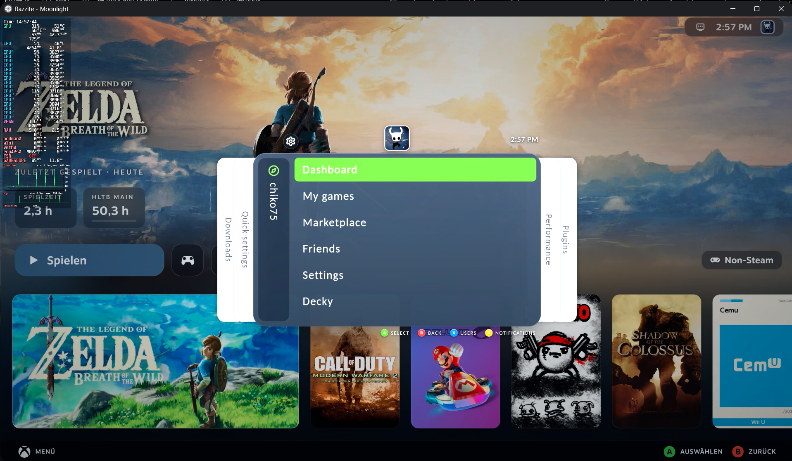
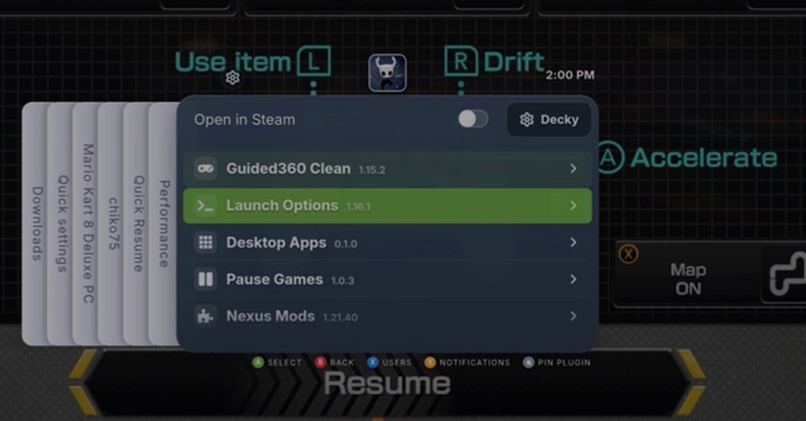
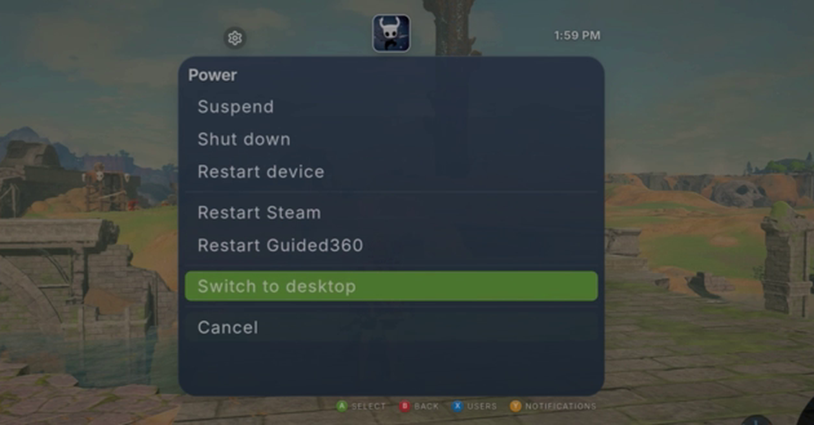

# Guided360

An Xbox 360 NXE style **Guide menu for Steam Game Mode** (SteamOS, Bazzite, …), packaged as a [Decky Loader](https://decky.xyz) plugin.
Press the Steam button and get the familiar blade layout: Downloads, Quick settings, your profile/main menu, Performance and Plugins. 

> **Based on [Game Glance](https://github.com/michpalm/game-glance) by Michael Palma (MIT).**
> Guided360 is a derivative work: it keeps only the menu and re-skins and extends it. See [Credits](#credits).

  

## Features

- Guide menu with quick settings (brightness, volume, microphone, Wi-Fi, Bluetooth devices), performance controls, downloads, friends with chat, notifications and user switching
- Styles: **Xbox 360** (default), **360 Slate** (minimal), **Liquid Glass**, **Dynamic** (colours follow the current game's artwork), **Console** (PS5-like Experiemental)
- Fine-tuning: size, colours, rounding, fonts, animations, sounds and volume, hide/reorder tabs, remap buttons
- Power view (sleep, restart, shut down, desktop) inside the Guide
- Languages: English, Deutsch, Español, Français, Português (or Auto from the Steam language)
- Experimental: running-app switcher and window list (depends on what Steam exposes) Works best with "Pause-Games"-Plugin.

## Install

1. Install [Decky Loader](https://decky.xyz).
2. Download the latest `Guided360-vX.Y.Z.zip` from [Releases](../../releases).
3. In Game Mode: Decky → settings (gear) → Developer → *Install plugin from ZIP*.
4. Restart Steam if the plugin does not appear.

Settings live in the Guide itself (gear icon → Appearance) and in Guided360's panel in the Decky menu.

## Status

Active hobby project, tested on a few Linux gaming setups only. **Not every Steam client version is covered**: Steam's internal menu code changes, and things like switching to Steam pages can break after a Steam update. Bug reports are very welcome – use the issue template and add a photo.

## Building from source

This repository holds the built plugin (`dist/index.js`) plus the Python backend. The plugin is produced by patching the compiled upstream Game Glance bundle; the build scripts are described in [`BUILDING.md`](BUILDING.md).

## Credits

- **Game Glance** by [Michael Palma](https://github.com/michpalm/game-glance), MIT – the foundation of this plugin.
- Fonts: Carlito, Inter and Poppins (SIL OFL 1.1).
- hltb-for-deck by hulkrelax (MIT), via upstream.

Details in [`THIRD_PARTY_LICENSES.md`](THIRD_PARTY_LICENSES.md) and [`LICENSE`](LICENSE).

## Disclaimer

Not affiliated with or endorsed by Valve, Microsoft, Sony or the Game Glance author. "Xbox", "Xbox 360", "PlayStation" and "iOS" are trademarks of their owners and are used only to describe the visual inspiration.

## License

MIT. The original copyright notice (Michael Palma) is retained as required.

---

# Deutsch

Guided360 ist ein Guide-Menü im Xbox-360-NXE-Stil für den Steam Game Mode (Decky-Plugin), basierend auf **Game Glance** von Michael Palma (MIT).

**Installation:** ZIP aus den [Releases](../../releases) laden und in Decky über Zahnrad → Entwickler → „Plugin aus ZIP installieren“ einspielen. Sprache und Stil stellst du im Guide unter Zahnrad → Darstellung ein.

**Hinweis:** Nach Steam-Updates kann einzelnes brechen (z. B. der Wechsel zu Steam-Seiten). Fehler bitte mit Foto als Issue melden.
